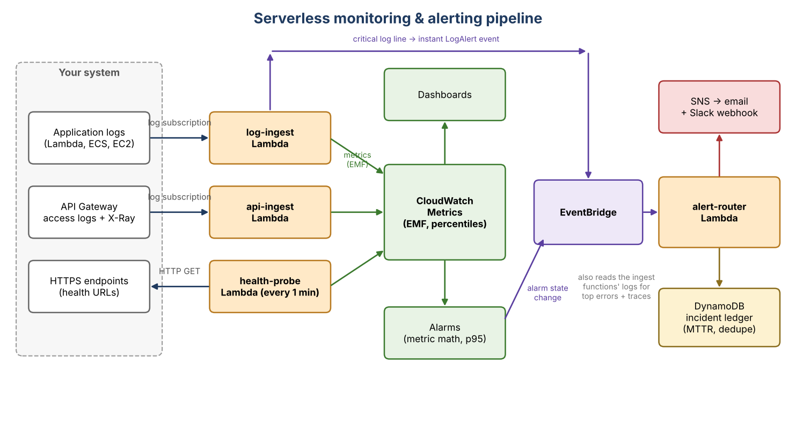
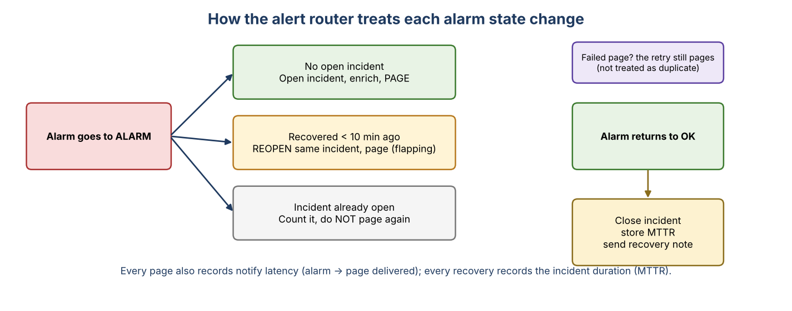

# Serverless Monitoring & Alerting Pipeline

Event-driven **AWS Lambda** functions (Python) that turn logs and API access logs into **CloudWatch** metrics, run
synthetic health probes, and route alarms to people with the context they need (top errors, failing requests, X-Ray trace
links, runbook), while tracking every incident so response time can be **measured**.

> **Status.** All code, infrastructure templates, scripts and a local simulator are included, with 115 automated tests.
> Everything that can run without an AWS account was run: the Lambda logic, the alert router, the alarm/dashboard generator
> and the CloudFormation structure checks. **It has not been deployed to AWS in this repo's preparation**: the CloudFormation/SAM
> templates and the real boto3 calls are untested against AWS (CI runs `cfn-lint` and `sam validate` for you).
> The "about a third faster incident response" figure is **not claimed here**: use [`scripts/incident_report.py`](#measuring-incident-response) on your own incidents.



## The pieces
| Component | Trigger | What it does |
|---|---|---|
| `log-ingest` | CloudWatch Logs subscription | Parses JSON or plain-text logs; emits per-minute metrics (errors, warnings, critical, latency distribution, Lambda duration/memory); logs top **error signatures**; publishes an EventBridge **LogAlert** for critical lines (timeouts, out-of-memory, CRITICAL, your own regex patterns) |
| `api-ingest` | CloudWatch Logs subscription | Parses API Gateway access logs; emits per-API and per-route metrics (requests, 2xx/3xx/4xx/5xx, slow requests, **latency and integration-latency distributions** so p50/p95/p99 work); logs **exemplars** (failed or slow requests with their X-Ray trace id) |
| `health-probe` | EventBridge schedule (1 min) | Calls your URLs in parallel; emits availability, response time, status code, TLS **certificate days remaining** |
| `alert-router` | EventBridge (alarm state changes + LogAlert events) | De-duplicates, opens/reopens/closes incidents in DynamoDB, enriches the alert, notifies via SNS (email) and an optional Slack/Teams webhook |
| CloudFormation | n/a | Pipeline stack (`template.yaml`) + generator for alarms and a dashboard for **your** services (`scripts/generate_alarms.py`) |

Metrics are written with the **CloudWatch Embedded Metric Format**: the Lambdas just print JSON, CloudWatch creates the
metrics. No `PutMetricData` calls, no extra permissions, no added latency. Metrics are stamped with the minute the event
happened, not the minute it was processed, so alarms and dashboards line up with reality.

### Metric reference
| Namespace | Dimensions | Metrics |
|---|---|---|
| `Monitoring/Logs` | Service | LogEvents, ErrorCount, WarnCount, CriticalCount, ParseFailures, RequestLatencyMs\*, LambdaDurationMs\*, LambdaInitMs\*, LambdaMaxMemoryMb |
| `Monitoring/Api` | Api, or Api + Route | RequestCount, Http2xx, Http3xx, Http4xx, Http5xx, SlowRequests, Latency\*, IntegrationLatency\* |
| `Monitoring/Probes` | Target | Availability, ResponseTimeMs, StatusCode, CertDaysRemaining |
| `Monitoring/Alerting` | Severity | AlertsSent, NotifyLatencySeconds, IncidentDurationSeconds, Suppressed |

\* distributions: use percentile statistics (p50, p95, p99) in alarms and dashboards.

## What a page looks like
This is the **real output of the alert router** on synthetic data from the local simulator (`python tools/simulate.py`):

```
[P1] ALARM: monitoring-svc-api5xx-orders-api
Target:   orders-api
What:     5xx rate of orders-api above 5% (ignored below 20 requests/min)
Why:      Threshold Crossed: 3 out of the last 5 datapoints were greater than the threshold (5.0).
Since:    2026-11-19 10:18:30 UTC
Runbook:  https://wiki.example.com/runbooks/api-5xx
Dashboard: https://ap-south-1.console.aws.amazon.com/cloudwatch/home?region=ap-south-1#dashboards:name=monitoring-overview
Alarm:    https://ap-south-1.console.aws.amazon.com/cloudwatch/home?region=ap-south-1#alarmsV2:alarm/monitoring-svc-api5xx-orders-api

Top errors (last 15 min):
  - 234x  DatabaseTimeout: database timeout while loading order 2697
  - 1x  2026-11-19T10:16:07Z req-x Task timed out after 10.00 seconds

Example failing/slow requests:
  - 500 GET /orders  4195 ms  (5xx)  https://ap-south-1.console.aws.amazon.com/xray/home?region=ap-south-1#/traces/1-67401717-2cf72140bd9bc648
  - 502 GET /orders  4177 ms  (5xx)  https://ap-south-1.console.aws.amazon.com/xray/home?region=ap-south-1#/traces/1-67401611-3f5e3b8cc0582da5
  - 503 GET /orders  4092 ms  (5xx)  https://ap-south-1.console.aws.amazon.com/xray/home?region=ap-south-1#/traces/1-67401504-f7bf52447db2a7aa
```

The router also fires an **instant, event-driven** alert for critical log lines (for example a Lambda timeout) without waiting for
an alarm to evaluate. The same problem is suppressed for 15 minutes so one bad deploy does not send 500 emails.



## Try it without AWS
```bash
pip install -r requirements-dev.txt
python -m unittest discover -s tests -t . -v      # 115 tests
python tools/simulate.py                           # 40 minutes of synthetic traffic with an outage, through the real handlers
python tools/check_template.py template.yaml generated/alarms.template.json
```

## Deploy
Needs the AWS SAM CLI and credentials.
```bash
sam build
sam deploy --guided          # asks for AlertEmail, ProbeTargets, etc. Confirm the subscription email you receive.
```
Useful parameters: `AlertEmail`, `SlackWebhookUrl`, `ProbeTargets` (JSON), `AlertPatterns` (regexes that page instantly), `ServiceMap`, `DeployDemoApp`.
If your account has never enabled API Gateway logging, deploy once with `ManageApiGatewayAccountRole=true` (it sets an account-wide setting).

1. **See it work with the demo app:** the stack deploys a small orders API that can fail on demand.
   `curl "$DemoApiUrl/orders?fail=1"` a few dozen times (or `?slow=2000`) and watch metrics and dashboards react.
2. **Connect your own services:**
   ```bash
   python scripts/subscribe_log_group.py --log-group /ecs/orders --kind app
   python scripts/subscribe_log_group.py --log-group /aws/apigateway/orders --kind api
   ```
   For API Gateway use the JSON access-log format from `template.yaml` (see the `DemoApi` resource) and turn on X-Ray tracing.
3. **Create alarms and a dashboard for them:**
   ```bash
   cp config/monitoring.example.json config/monitoring.json     # edit names, thresholds, runbook links
   python scripts/generate_alarms.py config/monitoring.json > generated/alarms.template.json
   aws cloudformation deploy --template-file generated/alarms.template.json --stack-name monitoring-alarms
   ```
   Per service: error volume. Per API: 5xx **rate** (ignored below a minimum request volume, so quiet APIs do not page on one error) and p95 latency.
   Per probe: availability (missing data counts as down) and certificate expiry. Alarm names start with `<project>-svc-`, which is what routes them.

CI (`.github/workflows/ci.yml`) runs the tests, `cfn-lint`, `sam validate` and the simulator on every push, and deploys from `main` when
`DEPLOY_ENABLED=true` (OIDC role, no stored keys).

## Measuring incident response
Every incident is stored in DynamoDB with when it opened, when the page was delivered, and when it recovered.
```bash
python scripts/incident_report.py --table monitoring-incidents --since 2026-09-01
python scripts/incident_report.py --table monitoring-incidents --baseline-csv before.csv     # compare with your "before"
```
`before.csv` has two columns, `opened_at,resolved_at`, from your old process (ticket system, spreadsheet, chat history).
The report prints mean, median and p90 time-to-recover, time-to-notify, and the percentage change, and warns when there are fewer
than 10 incidents on either side. Before/after comparisons only mean something for comparable incidents; say what you compared.

## Design notes and limitations
- **Delay.** Logs reach the ingest Lambdas within seconds, but a metric is typically visible to alarms 1 to 2 minutes after the event; an alarm needs several datapoints. Use the instant LogAlert path for things that must page immediately.
- **Cost control.** Every unique dimension combination is a billed custom metric. Route names are capped per batch (extra routes collapse into `OTHER`), and alert storms are capped per invocation.
- **No loops.** The pipeline ignores its own log groups and its own structured output.
- **Failure behaviour.** A failed page is retried and still pages (never mistaken for a duplicate); a failed enrichment never blocks a page; lost EventBridge publishes do not lose metrics; pipeline-health alarms notify SNS directly, so they still work if the router itself is broken. Failed async invocations go to an SQS dead-letter queue with an alarm.
- **Limits.** CloudWatch allows 2 subscription filters per log group. Alarm descriptions use `severity=P1; runbook=URL; text`. The Slack webhook URL is a NoEcho stack parameter stored in the function's environment; use Secrets Manager/SSM for production.
- **Not included yet:** multi-account/region aggregation, anomaly-detection or composite alarms, PagerDuty/Opsgenie, alert grouping across alarms, OpenTelemetry. (Natural next steps.)

## What was and was not verified
| Item | Status |
|---|---|
| Lambda handlers, parsing, aggregation, EMF output, alert router, incident ledger logic | Run and tested (115 tests, fake AWS clients) |
| Contract: every metric/dimension used by generated alarms and dashboards is actually emitted by the code | Tested |
| Probes against a real local HTTP server (success, 500, slow, timeout, refused) | Tested |
| CloudFormation structure (references, conditions, handler paths, env vars, dashboard JSON) | Checked with `tools/check_template.py` |
| boto3 calls against real AWS, SAM deploy, real alarm evaluation, email/Slack delivery | **Not run** (no AWS access); CI adds `cfn-lint` and `sam validate` |
| "Incident response time shortened by about a third" | **Not measured**: use the report script on your data |

## Layout
```
template.yaml            SAM stack: functions, SNS, DynamoDB, DLQ, EventBridge rules, pipeline dashboard + alarms, demo app
src/handlers/            log_ingest, api_ingest, health_probe, alert_router (Lambda entry points)
src/monitoring/          emf, cwlogs, logparse, aggregate, alerts, router, store, aws (shared logic)
src/demo_app/            small API with failure injection
scripts/                 generate_alarms, subscribe_log_group, incident_report
tools/                   simulate (local end-to-end run), check_template
config/, generated/      example alarm config and its generated CloudFormation
tests/                   115 tests
```
